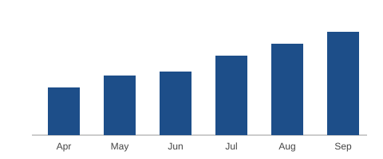

# Quarterly report: Q3 2026

Revenue grew for the third quarter in a row, led by the subscription plan.
This report covers sales, costs and the plan for Q4.

## Highlights

- Revenue reached **$1.42M**, up 18% on Q2.
- Churn fell to *2.1%* after the onboarding redesign.
- Two new regions went live: Singapore and São Paulo.



## Revenue by product

| Product      | Q2      | Q3      | Change |
| ------------ | ------: | ------: | -----: |
| Subscription | $820k   | $1,010k |   +23% |
| Services     | $260k   | $290k   |   +12% |
| Hardware     | $120k   | $120k   |     0% |
| **Total**    | $1,200k | $1,420k |   +18% |

## Plan for Q4

1. Ship annual billing.
2. Hire two support engineers for the new regions.
3. Cut infrastructure cost per customer by 10%.

> We will review the hiring plan again in mid-November once the Q4 pipeline is clear.

```text
Conversion run: proteus-server sample "report"
```
